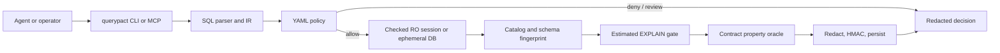

# QueryPact

QueryPact verifies PostgreSQL SQL and migrations proposed by AI agents and other automated clients against operator policy and declared contracts. It provides bounded analysis and verification, returning structured decisions and attestations without returning real database rows.

QueryPact is a local CLI and MCP server over stdio. It is not a chatbot, text-to-SQL generator, database administration tool, or general SQL executor. There is no `execute_sql` command or MCP tool; clients provide configured target aliases rather than connection strings. QueryPact-authored code is MIT-licensed. Third-party files retain their own licenses and attributions.

## Safety and support

- PostgreSQL is the supported database.
- QueryPact currently supports running from source on Linux x64 with the .NET 10 SDK. No prebuilt QueryPact binaries are distributed.
- Windows x64 source compatibility has been validated for restore, build, and tests. Running or distributing a Windows binary is not currently a supported public release surface. macOS is unverified.
- `Sav.*` namespaces, `SAV_*` configuration keys, and `sav_ro_probe` are compatibility/internal contracts; they do not indicate platform support. Docker is required for migration, ephemeral-database, and Testcontainers tests.
- Real targets use checked read-only sessions. Migrations use an ephemeral database, never a real target alias.
- Unsupported, ambiguous, dynamic, and unparsable SQL fails closed.
- Responses, strict logs, and attestations exclude real row payloads. This does not imply zero server CPU/I/O, timing, NOTICE, or function-side effects.
- HMAC provides local tamper detection for redacted attestations; it is not a manufacturer signature or cross-host trust system.

Read the [security model](docs/product/02_SECURITY_MODEL.md) before connecting QueryPact to a sensitive database.

## Build from source

Requirements: Git and the SDK selected by [`global.json`](global.json). Docker is required for migration, ephemeral-database, and Testcontainers tests. A PostgreSQL target is needed only for real-target verification.

```sh
dotnet restore
dotnet build -c Release
dotnet run --project src/Sav.Host/Sav.Host.csproj -c Release -- --help
```

### Platform support

| Platform | Public support status |
| --- | --- |
| Linux x64 | Supported for running QueryPact from source |
| Windows x64 | Source restore/build/test compatibility validated; executable runtime and binary distribution are not a supported public release surface |
| macOS | Unverified; support is not claimed |

There are no prebuilt downloads. On Linux x64, run commands from source with `dotnet run --project src/Sav.Host/Sav.Host.csproj -c Release -- ...` (after restore/build). Windows publish tooling is maintainer/development tooling for an unreleased binary path; see [Windows executable verification](docs/release/windows-querypact-verification.md). `WINDOWS BINARY RELEASE` and `publicReleaseGate=BLOCKED` remain unchanged.

## Modes and first use

| Mode | Commands/tools | HMAC key |
| --- | --- | --- |
| `AnalyzeOnly` | `analyze`, `mcp serve`, help, version; MCP `analyze_sql` | Not required |
| `Full` (default) | All commands and MCP tools | Required at startup |

`--mode` overrides `SAV_MODE`. Full mode requires `SAV_ATTESTATION_HMAC_KEY` with a `base64:` or `hex:` prefix and at least 32 decoded bytes. Help/version do not build Full-mode services.

```sh
export SAV_MODE=AnalyzeOnly
export SAV_CONFIG_ROOT="$PWD/tests/fixtures"
dotnet run --project src/Sav.Host/Sav.Host.csproj -- analyze --sql 'SELECT 1' --policy policies/valid-basic.yaml --contract contracts/valid-basic.yaml
```

Success is redacted JSON on stdout; errors are structured JSON on stderr. See the [CLI and MCP reference](docs/CLI_REFERENCE.md) for configuration, exit behavior, YAML input, and MCP use.

## Execution limits

These are protective defaults, not a performance SLA. End-to-end time depends on SQL complexity, database load, Docker image availability, network latency, and PostgreSQL configuration.

| Path | Default | Meaning |
| --- | --- | --- |
| Real alias | statement 5 s; lock 2 s | PostgreSQL work in a read-only session |
| Verification pipeline | 30 s wall-clock check | Later fingerprint check returns `schema_changed` when exceeded |
| Ephemeral session | statement 3 s; lock 1 s | Temporary PostgreSQL work |
| Migration use case | statement 5 s | Passed to shadow runner |
| Parsing/pure analysis | No numerical budget | Cancellation accepted; native parser cancellation is best-effort |

QueryPact provides no throughput, latency, or resource-use guarantee. Benchmark fixtures are security evidence, not a production performance baseline.

## Architecture



`analyze` stops after parsing and policy; it never opens PostgreSQL or attests. Verification short-circuits before session use on deny, review, or parse failure. One verified read-only session is reused for catalog, plan, oracle, and fingerprint work. See the [developer guide](docs/DEVELOPER_GUIDE.md) for algorithms, limitations, extension points, and tests.

## Documentation

- [CLI and MCP reference](docs/CLI_REFERENCE.md)
- [Developer guide](docs/DEVELOPER_GUIDE.md)
- [Read-only probe setup](docs/release/ro-probe-setup.md)
- [Security model](docs/product/02_SECURITY_MODEL.md)
- [Architecture decisions](docs/adr/)
- [Source redistribution records](redistribution/README.md)

## License and contribution

QueryPact-authored code is MIT-licensed; this does not relicense separately licensed third-party files. Preserve [`LICENSE`](LICENSE), [`NOTICE`](NOTICE), [`THIRD_PARTY_LICENSES.md`](THIRD_PARTY_LICENSES.md), and files identified by the [`redistribution tooling`](redistribution/README.md). Release tooling can produce local evidence, but this repository does not distribute prebuilt binaries.

See [`CONTRIBUTING.md`](CONTRIBUTING.md) and the developer guide before modifying code. Report vulnerabilities privately using [`SECURITY.md`](SECURITY.md).
