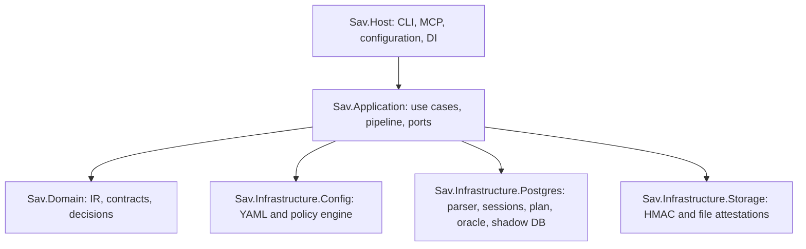

# Developer guide

This guide explains the behavior implemented in `src/` and the tests that
protect it. If it differs from shipped code, an accepted ADR, or a security
test, the code/tests are authoritative; update this guide in the same change.

## Purpose and non-goals

QueryPact verifies PostgreSQL SQL proposed by automated clients. It makes a bounded
policy decision and evaluates explicit contract properties without releasing
real result rows. It intentionally does not generate SQL, execute arbitrary SQL
for clients, support other engines, provide a web UI, or automate human
approval.

Do not broaden this boundary with an executor, agent-supplied DSNs, a second
runtime, or a pass-through output path without a security design and ADR.

## Architecture



| Project | Responsibility | Must not contain |
| --- | --- | --- |
| `Sav.Domain` | Immutable contracts, SQL IR, decisions, properties, attestations, errors | Infrastructure dependencies or concrete database work |
| `Sav.Application` | Use cases, `VerificationPipeline`, ports, orchestration | YamlDotNet, Npgsql, filesystem, concrete adapters |
| `Sav.Infrastructure.Config` | YAML loaders, path-aware configuration, `YamlPolicyEngine` | PostgreSQL execution |
| `Sav.Infrastructure.Postgres` | Parser, Npgsql aliases/sessions, catalog, plans, property oracle, shadow migrations, PG redaction | YAML policy decisions or host wiring |
| `Sav.Infrastructure.Storage` | File store and HMAC implementation | PostgreSQL |
| `Sav.Host` | Executable, CLI, MCP adapters, DI profiles, environment config | Domain/business decisions |

Application depends on ports including `ISqlParser`, `IPolicyEngine`,
`IReadOnlySessionFactory`, `ICatalogResolver`, `IPlanProvider`,
`IPropertyOracle`, `IShadowMigrationRunner`, `IRedactor`, and
`IAttestationStore`. Keep boundaries explicit. New I/O/long-running APIs need
a `CancellationToken`.

## Algorithms and business logic

### SQL parsing and IR

`LibPgQuerySqlParser` uses `pgsqlparser` (native `libpg_query`), not regex or a
hand-written tokenizer. `SqlIrMapper` produces the Domain SQL IR: statement
types, tables/columns read or written, functions, internal operator names, risk
codes, multiple statements, dynamic SQL, and unresolved objects. Operator names
are retained only for live catalog safety validation. Parse failure becomes an
unparsable analysis and is denied fail-closed. Top-level `MergeStmt` is
marked `unsupported_construct` even when allowed in YAML. The existing
nested-write traversal also detects embedded `MergeStmt`, including in
`EXPLAIN MERGE` and `EXPLAIN (ANALYZE) MERGE`; it does not attempt complete
MERGE action-column extraction. `LibPgQuerySqlParserTests` and
`MergeFailClosedTests` cover these fail-closed paths.

Only structural analysis can leave the verifier. `NormalizedSql` must not enter
persisted/external attestations; external mapping uses `StructuralSqlIr` and
`AttestationAnalysis`.

### YAML authorization

`YamlPolicyEngine` evaluates, in order:

1. Parsability.
2. Multiple statements and allowed statement types.
3. Denied tables and columns.
4. Function allow-list; an empty list denies all functions.
5. Unresolved objects and unsafe UPDATE/DELETE without a predicate.
6. Unsupported/dynamic constructs.
7. `needs_review` risks.

Violations deny; review risks return review; otherwise policy allows. Contracts
then select required properties. Policy and contract disclosure profiles are
intersected, never widened.

### Query verification

`VerificationPipeline` owns real-alias verification:

1. Parse and apply policy. Deny/review/unparsable returns with no PostgreSQL.
2. Reject empty/unsupported real-alias property sets before a session.
3. Open one `IReadOnlySession`, enrich from catalog, validate operator safety,
   and re-run policy. An explicitly non-`pg_catalog` operator, or an unqualified
   operator name with any visible non-`pg_catalog` definition, is marked
   `unsupported_construct` before plan/oracle execution.
4. Capture/recheck a schema fingerprint, run `EXPLAIN (FORMAT JSON)`, and apply
   the plan gate. Deny/review skips the oracle.
5. Recheck fingerprint, evaluate properties, map decision, redact, HMAC, store.

The same verified session is reused for catalog, plan, oracle, and fingerprint
work. Do not open another connection from those consumers. Fingerprinting is a
TOCTOU mitigation, not strong isolation.

### Database and oracle controls

`ReadOnlySessionFactory` resolves target aliases, opens Npgsql, applies timeouts,
and uses `ReadOnlySessionGuard`. The guard uses the `public.sav_ro_probe` DML
canary plus read-only transaction state. Missing/ambiguous probes, writable
roles, and unconfirmed rollback reject the session; unconfirmed rollback marks
the alias unsafe.

`ExplainPlanProvider` runs estimated `EXPLAIN (FORMAT JSON)`, never default
`EXPLAIN ANALYZE`. It buckets cost and only exposes allow-listed nodes/risk
flags. `PropertyOracle` uses typed templates and allowed scalar columns, never
raw rows. Real aliases support `query_succeeds`, `empty_result`, `unique`, and
`non_null`. Schema/orphan/affected-row work is ephemeral; equivalence has its
own use case.

`VerifyMigrationUseCase` authorizes before `ShadowMigrationRunner` starts
Testcontainers PostgreSQL and applies base schema/migration. Migrations never
resolve a real target alias.

### Redaction and attestations

Every egress crosses `IRedactor`. Host DI must use a production redactor, never
a pass-through test fake. `AttestationFactory` creates redacted output;
`AttestationHmac` signs it; `FileAttestationStore` persists it and checks
integrity on read. This HMAC is local tamper evidence only.

## Defaults and limitations

| Control | Default | Owner |
| --- | --- | --- |
| Real-alias statement timeout | 5 seconds | `ReadOnlySessionOptions` |
| Real-alias lock timeout | 2 seconds | `ReadOnlySessionOptions` |
| Pipeline wall-clock guard | 30 seconds | `SchemaFingerprintGuard` |
| Ephemeral statement/lock timeout | 3 seconds / 1 second | `EphemeralSessionFactory` |
| Migration use-case timeout | 5 seconds | `VerifyMigrationUseCase` |

These protections are not a performance SLA. Native parsing cancellation is
best-effort; Docker startup, network, database contention, plans, and server
load affect total time.

Known limitations:

- PostgreSQL only. Linux x64 is the supported platform for running QueryPact
  from source. Windows x64 source restore/build/test compatibility is validated;
  executable runtime and binary distribution are not a supported public release
  surface. macOS is unverified. No prebuilt binaries are distributed.
- `Sav.*` namespaces, `SAV_*` configuration keys, and `sav_ro_probe` are
  compatibility/internal contracts, not platform-support claims.
- No formal anonymity, differential privacy, complete side-channel protection,
  or proof that an incomplete contract captures user intent.
- The oracle can still use database CPU/I/O and create timing/NOTICE/function
  effects. Snapshot-only verification is future work.
- Unsafe probe triggers/rules/FKs may have effects before rollback; keep the
  probe isolated as the runbook requires.
- Schema fingerprints detect selected drift at checkpoints, not all TOCTOU.
- Quoted/mixed-case oracle identifiers fail closed in this MVP.
- Review is a decision, not a built-in approval workflow.
- Parser packaging determines whether a release is SQL-capable.

| QueryPact does well | QueryPact is not designed to do |
| --- | --- |
| Reject unsupported/ambiguous SQL early | Prove arbitrary SQL harmless |
| Keep DSNs out of agent arguments | Replace PostgreSQL privileges or secret storage |
| Check small explicit properties with typed templates | Return general query results |
| Avoid raw rows, raw errors, and default EXPLAIN ANALYZE | Guarantee zero DB resource use |
| Produce local tamper-evident redacted attestations | Create globally trusted signatures |
| Keep aliases read-only and migrations ephemeral | Execute production DDL/DML for agents |

## Modification guide

Make the smallest coherent change; add tests at the owning layer and security
tests whenever authorization, egress, or a DB boundary changes.

| If you change... | Primary location | Required follow-up |
| --- | --- | --- |
| CLI command/option | `src/Sav.Host/Cli/`, `Program.cs` | Host CLI contract/E2E tests; CLI reference |
| MCP tool | `src/Sav.Host/Mcp/Tools/`, `SavMcpServer.cs` | MCP contracts and stdout-isolation tests |
| Policy rule/YAML field | Domain Policies, Config Policies/loaders | Config tests, pipeline short-circuit tests, fixtures/docs |
| Contract property | Domain Contracts, Application abstractions, Postgres Oracle/Properties | Loader, use-case selection, oracle, no-leak tests |
| Parser/IR mapping | Domain Analysis, Postgres Parsing | Parser fixtures, fuzz/differential tests, policy tests, ADR if package behavior changes |
| Alias/session/timeout | Postgres Targets, `PgSessionTimeouts.cs` | Session, cancellation, RO-probe tests and runbook |
| Catalog/fingerprint/plan | Postgres Catalog/Plans, pipeline | Fingerprint/plan/ordering tests |
| Redaction/response shape | Redaction, response records, Host JSON/MCP mapping | No-leak, egress, and host-contract tests |
| Attestation/HMAC/storage | Domain/App Attestations, Storage | Canonical JSON, tamper, concurrency, compatibility tests |
| Shadow migration | App/Postgres Migrations and Oracle ephemeral session | Migration integration tests and Docker docs |
| Dependencies/publish | Packages, global.json, native props, publish scripts | ADR 0001/0002, source tests, licenses, release docs; Windows publishing is unreleased maintainer tooling |

Safe-change rules:

1. Keep Domain infrastructure-free and Application dependent on ports.
2. Use typed `SavErrorCode` values and redact all user-visible details. Never
   leak SQL literals, DSNs, raw PostgreSQL errors, rows, plans, or stack traces.
3. A real-alias operation stays read-only; write behavior belongs in an
   ephemeral path or is out of scope.
4. Preserve pipeline short-circuits: do not open a session, EXPLAIN, or call an
   oracle after a deny/review stage.
5. Update `CHANGELOG.md` for user-visible/security changes; write an ADR for a
   material architecture decision; update third-party notices for dependency
   changes.

## Testing and quality gates

The xUnit suites mirror production boundaries:

| Suite | Main purpose |
| --- | --- |
| `Sav.Domain.Tests` | Value objects, decisions, canonical JSON, contracts, IR |
| `Sav.Application.Tests` | Use cases, pipeline ordering, short-circuiting |
| `Sav.Infrastructure.Config.Tests` | YAML, policy, config paths |
| `Sav.Infrastructure.Storage.Tests` | HMAC, store integrity/concurrency |
| `Sav.Infrastructure.Postgres.Tests` | Parser, sessions, catalog, plans, oracle, migrations |
| `Sav.Host.Tests` | CLI, MCP, DI, cancellation, published executable smoke |
| `Sav.Security.Tests` | Bypass, no-leak, authorization, surface, benchmark regressions |

Run from the repository root:

```powershell
dotnet restore
dotnet build -c Release
dotnet test -c Release
powershell -NoProfile -File scripts/Test-NoMojibake.ps1
```

Windows publish and generated-executable smoke tooling is retained for
maintainer investigation of an unreleased binary path. It is not a public
runtime or distribution promise. If Windows Defender Application Control blocks
such local smoke tests, use this focused source-test filter while investigating
policy:

```powershell
dotnet test -c Release --filter "FullyQualifiedName!`NativeParserPublishSmokeTests&FullyQualifiedName!`Published"
```

Focused examples:

```powershell
dotnet test tests/Sav.Application.Tests/Sav.Application.Tests.csproj -c Release
dotnet test tests/Sav.Security.Tests/Sav.Security.Tests.csproj -c Release
dotnet test tests/Sav.Host.Tests/Sav.Host.Tests.csproj -c Release
```

Add a regression test at the lowest owning layer, plus integration/security
coverage when behavior crosses a boundary. Never delete or weaken a test simply
to make CI pass. This is a C#/.NET repository: Python/Ruff commands do not
apply; use the .NET build/tests, encoding script, publish smoke where relevant,
and `git diff --check`.

## Licenses and next steps

QueryPact-authored code is MIT-licensed. Preserve `LICENSE`, `NOTICE`, and `THIRD_PARTY_LICENSES.md`.
Versions are centralized in `Directory.Packages.props`. When changing a
production dependency, verify its exact redistribution license, update the
notice, and inspect the Release SPDX SBOM. The parser stack includes
`pgsqlparser`, `libpg_query` (BSD-3-Clause), and PostgreSQL parser sources
(PostgreSQL License); consult ADR 0002 before changing it.

Potential next steps, not approved work: supported Linux packaging with the
same smoke evidence; a lower-side-effect/snapshot oracle; stronger TOCTOU
semantics; approval/audit ports for review workflows; carefully threat-modelled
property expansion; and signed release artifacts with stronger key management.
